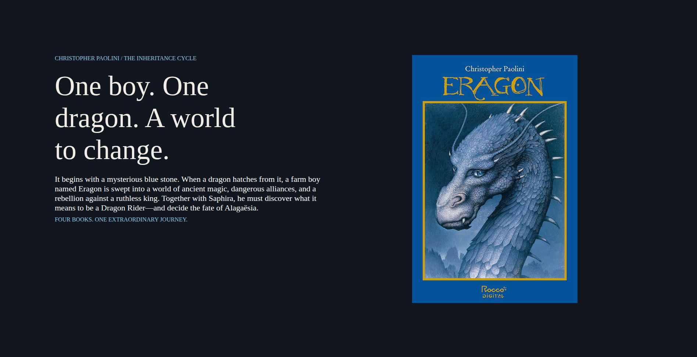

# 🐉 Eragon Landing Page

Uma aplicação web interativa desenvolvida para praticar marcação semântica em HTML5, estilização dinâmica com CSS3 e estruturação visual temática baseada na saga literária *The Inheritance Cycle*.

---

## 🚀 Funcionalidades

- 🐉 **Apresentação da saga:** Exibe o conceito e a sinopse principal do livro e do universo de Alagaësia.
- 📚 **Informações literárias:** Apresenta a coleção dos livros da série (*Eragon*, *Eldest*, *Brisingr* e *Inheritance*) com suas respetivas capas.
- 🎨 **Interface dinâmica:** Estruturação visual temática focada em leitura imersiva e apresentação do autor.

---

## 🛠️ Tecnologias Utilizadas

